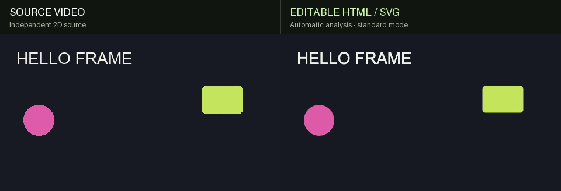
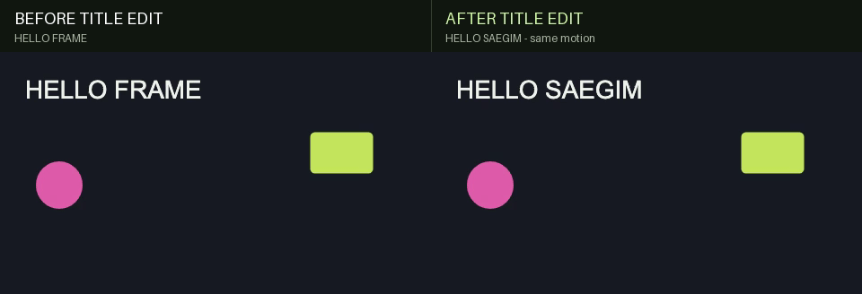
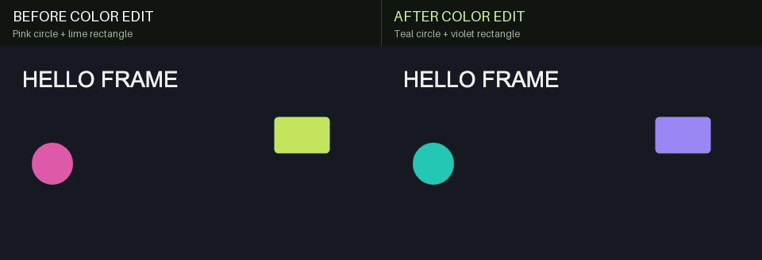

# 새김 · Saegim

[English](README.md) · 한국어

로컬 2D 모션그래픽 영상을 분석해 편집 가능한 HTML/SVG 애니메이션으로 재구성하는 실험용 도구입니다. 텍스트·도형·윤곽선·그라데이션과 시간별 관측을 프로젝트 JSON으로 저장하고, 웹 편집기에서 문구·색상·위치·크기를 수정합니다.

특정 작품의 영상, 장면 좌표, 캐릭터 팔레트, 수작업 마스크 없이 실행할 수 있습니다. 원본 영상은 비교용이며, 내보낸 HTML은 SVG 요소와 스크립트로 장면을 재생합니다.

## 기능을 눈으로 확인하기

**영상 가져오기 → 요소로 변환 → 제목·색상 수정** 흐름입니다. 아래는 직접 만든 **3초짜리 검증 영상**을 macOS에서 빠른 분석(`standard`, 초당 30표본)한 실제 렌더입니다. 글꼴·색상·세부 경계 차이가 남아 있으며, 이 단순한 예제가 모든 영상의 변환 품질을 대표하지는 않습니다.

### 1. 원본 영상과 SVG 변환 결과



**왼쪽은 원본, 오른쪽은 자동 변환 결과**입니다. 텍스트 1개·타원 1개·사각형 1개로 분리됐으며 수동 윤곽 보정은 하지 않았습니다. 내보낸 장면은 원본 영상을 삽입한 것이 아니라 SVG 요소로 그립니다.

### 2. 움직임은 유지하면서 제목 수정



텍스트 요소 선택 → **텍스트** 입력 → 내보내기. `HELLO FRAME`을 `HELLO SAEGIM`으로 바꿨으며 도형과 움직임은 유지했습니다. [제목 편집 프로젝트](examples/reconstruction-demo/title-edited.json).

### 3. 도형 색상 수정



도형 선택 → **채우기** 색상 변경. 원은 청록색(`#25c6b5`), 사각형은 보라색(`#9b87f5`)으로 바꿨습니다. 제목·형태·움직임은 동일하며 단색 채우기 편집의 예시입니다. [색상 편집 프로젝트](examples/reconstruction-demo/colors-edited.json).

**직접 해보기:** 아래 설치를 마친 뒤 **프로젝트 열기**에서 [편집 전 프로젝트](examples/reconstruction-demo/project.json)를 불러오세요. 위 세 버전을 모두 제공합니다. [원본 생성 방법·재현 절차·검증 내용](examples/reconstruction-demo/README.md).

## 시작하기

Node.js 20.19 이상과 Python 3.10 이상이 필요합니다. 저장소 루트에서 실행합니다.

```sh
npm ci
npm run setup
npx playwright install chromium
npm run doctor
npm run dev
```

웹 편집기는 `http://127.0.0.1:5173`, 분석 API는 `http://127.0.0.1:8000`에서 실행됩니다. 두 포트가 사용 중이면 실행이 중단되므로 충돌한 포트를 비웁니다. 이미 실행 중인 이 앱의 API를 유지하려면 `npm run dev:web`만 실행합니다. 편집기 포트를 바꾸려면 `npm run dev:web -- --port 5188`을 사용합니다. `FRAMEFORM_PYTHON`으로 환경 준비에 사용할 Python을 지정할 수 있습니다.

1. 영상 파일을 업로드하고 분석 품질과 필요한 구간을 선택합니다.
2. 원본과 재구성 화면을 비교하고, 요소를 선택해 문구와 스타일을 수정합니다.
3. 프로젝트 JSON을 저장해 편집을 이어가거나 독립 실행 HTML을 내보냅니다.

재생바의 **프레임 다시 그리기**를 켜면 관측 시각마다 도형·그라데이션·텍스트로 SVG 화면을 새로 만듭니다. 프레임 간 겹침과 배경·전경 수식 연결은 적용하지 않으며 해당 데이터는 보존합니다. 스크립트는 프레임 시각을 선택하고 화면을 교체합니다. 원본 관측이 적으면 움직임이 계단식으로 보일 수 있으며, 이 모드가 누락된 도형이나 디테일을 복원하지는 않습니다. 편집과 JSON·HTML 내보내기에도 같은 모드가 유지됩니다.

분석에는 외부 AI API 키가 필요하지 않습니다. OCR은 현재 macOS Vision/Swift를 사용합니다. 다른 운영체제에서는 도형 분석을 사용할 수 있지만 자동 텍스트 인식은 제공되지 않습니다. OCR로 검출되지 않은 글자는 윤곽 도형으로 남을 수 있습니다.

## 다른 영상에 적용하기

`npm run dev`를 실행해 둔 상태에서 별도 터미널로 진행합니다. 입력과 결과 경로는 직접 지정합니다.

```sh
npm run workflow -- analyze \
  --input /path/to/input.mp4 \
  --out-dir artifacts/my-video \
  --quality high --sample-fps 24

npm run workflow -- render \
  --project artifacts/my-video/project.json \
  --out-dir artifacts/my-video/render \
  --fps 24 --width 960

npm run workflow -- compare \
  --source /path/to/input.mp4 \
  --rendered artifacts/my-video/render/preview.mp4 \
  --output artifacts/my-video/comparison.gif
```

편집한 결과를 렌더링하려면 웹앱에서 저장한 JSON을 `--project`에 전달합니다. 세 명령은 기존 주요 출력이 있으면 중단하며, 덮어쓰려면 `--overwrite`를 지정합니다. `render --html-only`는 MP4 생성을 생략합니다. MP4와 GIF에는 원본 오디오가 포함되지 않습니다.

업로드는 최대 100 MiB, 분석 대상은 0.2~60초, 최대 4K입니다. 30초를 넘으면 API가 처리 구간으로 나누어 composition 프로젝트로 조립합니다. 더 긴 원본에서 구간을 선택하려면 `--clip-start 10 --clip-end 20`을 함께 사용하고 비교 명령에는 `--source-start 10`을 지정합니다. 원본 파일의 업로드 용량 제한은 그대로 적용됩니다.

빠른 `standard` 모드에서 `--sample-fps`를 조정할 수 있습니다. `high` 모드는 원본 FPS와 24 중 작은 값을 사용합니다. 짧은 영상도 복잡한 조명·질감 때문에 프로젝트 한도(요소 8,000개 등)를 넘을 수 있습니다. 고품질 분석이 한도로 중단되면 더 짧은 구간으로 나누거나 `standard`로 시도합니다. 빠른 분석은 검출 요소를 줄일 수 있으므로 프로젝트의 분석 경고와 비교 화면을 확인해야 합니다.

상세 입력 계약, 옵션, 자체 검증 영상 및 도형 연결 예제는 [스크립트 안내](docs/scripts.md)에 있습니다. 실행 목록은 `npm run workflow -- list`, 기계 판독 목록은 [catalog.json](scripts/catalog.json)입니다.

부품별 원본 비교는 `.venv/bin/python scripts/compare-parts.py --manifest artifacts/my-video/comparison-input.json --out-dir artifacts/my-video/part-comparison`로 실행합니다. 호출자가 정한 고정 영역에서 원본과 실제 렌더를 비교하며, [입력 계약과 측정 한계](docs/scripts.md#부품별-원본-비교)를 확인하세요.

## 컷별 SVG 요소 분리

`npm run workflow -- elements --project <project.json> --regions <regions.json> --out-dir artifacts/my-elements`로 대표 시각의 캐릭터·소품·배경 영역을 투명 SVG, 이름이 있는 레이어 SVG, 오프라인 요소 라이브러리와 ZIP으로 내보냅니다. 입력 영상마다 의미 영역 마스크를 주석 데이터로 지정해야 하며 `--smooth-px 3`으로 윤곽을 곡선화하고, `surface` 주석으로 가려진 면을 완전한 도형으로 채울 수 있습니다. `workflow fit-surfaces`는 주변의 보이는 색을 측정해 배면 그라데이션을 맞춥니다. 배면 도형은 입력 데이터로 제공하며 자동 의미 분할이나 숨은 형상 추론 기능은 아닙니다. 실제 컷 경계는 프로젝트의 `temporal.cuts`를 사용하고, 편집 구간·분석 처리 구간과 구분합니다. [영역 입력 형식](docs/scripts.md#컷별-svg-요소-내보내기)을 참고하세요.

## 재사용 스킬

[Motion Graphics Reconstruction](.agents/skills/motion-graphics-reconstruction/SKILL.md)은 이 저장소에서 영상 분석, 편집 보존, 수식 기반 연결, 원본 비교를 진행하는 작업 지침입니다. 저장소와 함께 사용하며 스킬 폴더만 복사하면 실행 엔진은 포함되지 않습니다.

예시 요청:

> $motion-graphics-reconstruction 이 로컬 영상을 편집 가능한 HTML/SVG로 변환하고, 지정한 요소의 색상만 바꾼 뒤 원본과 비교 GIF를 만들어줘.

스킬은 입력 영상의 길이, 화면 크기, 장면 경계, 수정할 대상과 재질 그룹을 실행 시 결정합니다. 특정 작품이나 캐릭터 이름을 가정하지 않습니다.

[Vector Part Source Matching](.agents/skills/vector-part-source-matching/SKILL.md)은 이미 변환한 부품을 원본과 반복 비교해 윤곽·겹침·그라데이션을 다듬는 동반 스킬입니다. 수정 전과 후보의 실제 렌더를 같은 영역에서 비교하고, 개선되지 않은 수정은 되돌리며 텍스트 편집과 시간 설정을 보존합니다. 가려진 면은 추정으로 구분합니다.

> $vector-part-source-matching 각 부품을 원본과 비교하고, 오차가 큰 부분부터 수정·렌더·검수를 반복해줘. 제목 편집과 프레임별 다시 그리기는 유지해줘.

## 구조와 현재 범위

| 경로 | 역할 |
| --- | --- |
| `src/components`, `src/App.tsx` | 영상 가져오기, 요소·텍스트 편집, 비교 UI, 로컬 저장 |
| `src/engine` | 프로젝트 검증, 시간 평가, SVG 렌더링, 독립 실행 HTML |
| `server` | 로컬 영상 분석, OCR, 도형·색상 추정, 추적, 컷 감지, 긴 영상 조립 |
| `scripts` | 범용 분석·렌더·비교·검증·소스 패키징 및 SVG 요소 분리 도구 |
| `tests` | 합성 데이터 기반 엔진·API·브라우저 검증 |
| `.agents/skills` | 저장소용 재사용 작업 지침 |

앱은 `schemaVersion: 1` 단일 프로젝트와 `schemaVersion: 2` 압축 구간 composition을 사용합니다. 관측 도형을 연결하는 `object_scene_tracks.py`와 `object-scene-runtime.mjs`, 수치 변환을 실험하는 `parametric-vector-model.mjs`는 별도의 모델 형식을 사용합니다. 이 실험 라이브러리의 출력을 앱 프로젝트인 것처럼 불러올 수는 없습니다.

일반 영상 분석이 모든 캐릭터를 의미 단위로 분해하거나 가려진 구조를 복원하지는 않습니다. 복잡한 질감·가림·빠른 변형에서는 윤곽과 대응 관계를 추가 검수해야 합니다. 관측 사이 보간은 원본의 실제 중간 프레임을 보장하지 않으며 컷을 넘어 연결하지 않아야 합니다. 색상을 직접 변경하는 앱 기능은 추정된 색상·음영 변화를 단색으로 통일할 수 있습니다. 음영을 보존하는 선택적 재질 편집은 별도 도형 모델과 대상 그룹 지정이 필요합니다.

## 검증

```sh
npm test -- --maxWorkers=1
.venv/bin/python -m pytest tests/backend
npm run build
npm run test:e2e
npm run test:workflow
npm run test:elements
npm run release:check
```

Windows에서는 Python 경로를 `.venv/Scripts/python.exe`로 바꿉니다. 브라우저 검증에는 Chromium이 필요합니다. 외부 영상 없이 자체 도형 영상을 만드는 검증 흐름은 [스크립트 안내](docs/scripts.md#외부-영상-없이-검증하기)를 참고합니다. 선택적 실영상 테스트는 `FRAMEFORM_VIDEO_FILE`로 로컬 파일을 지정해야 실행됩니다.

`test:workflow`는 외부 영상이나 API 없이 짧은 합성 입력으로 실제 HTML·MP4·GIF 명령, 소수 FPS, 종료 시각, 컷과 오프라인 텍스트를 검사합니다.

GitHub Actions는 엔진·백엔드·워크플로 테스트, 빌드, 공개 소스 검사를 실행하도록 구성되어 있습니다. CI 실행 성공 여부는 실제 GitHub 실행 결과로 확인합니다. 비교 GIF의 시간·프레임 검증이나 픽셀 차이를 원본 재현 정확도 백분율로 표현하지 않습니다.

## GitHub용 소스 패키지

```sh
npm run release:check
npm run release:package
```

`dist/github-source/saegim-source.zip`에 공개 소스와 파일별 SHA-256 목록을 담고, 압축을 다시 읽어 원본 바이트와 비교합니다. 이 명령은 GitHub 업로드나 커밋을 수행하지 않습니다. [공개 준비 안내](docs/github.md)를 참고하세요.

`.gitignore`는 입력 영상, 변환 결과, 캐시, 의존성, 로컬 실험 기록과 특정 영상 전용 스크립트를 제외합니다. 기존 로컬 자료는 삭제하지 않습니다. 새 범용 스크립트를 추가할 때는 허용 목록과 `scripts/catalog.json`을 함께 갱신합니다.

프로젝트 소스는 [MIT 라이선스](LICENSE)로 공개합니다. 포함된 글꼴의 라이선스와 출처는 [THIRD_PARTY_NOTICES.md](THIRD_PARTY_NOTICES.md)에 기록되어 있습니다.
