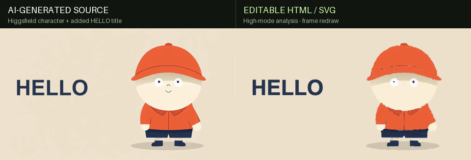
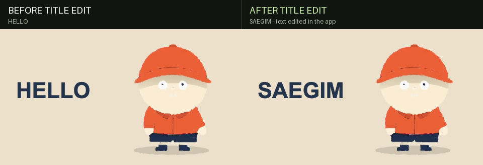
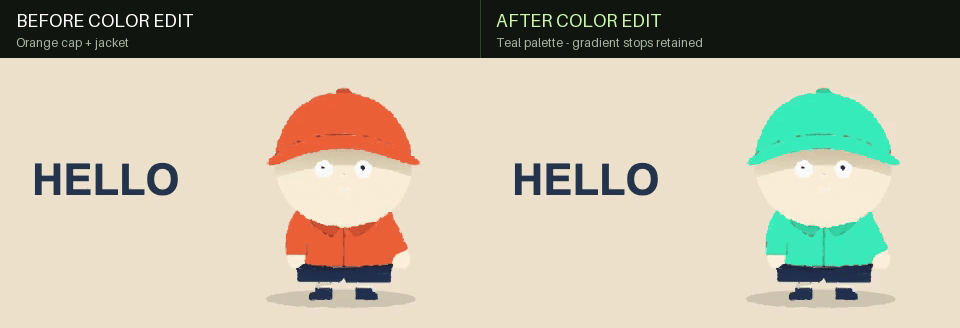
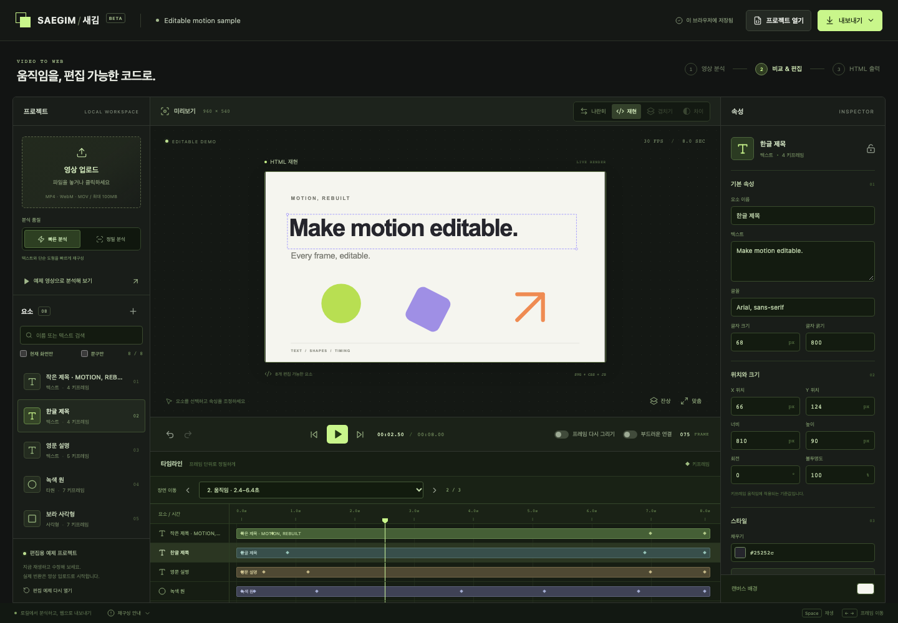

# 새김 · Saegim

**Reconstruct local motion graphics as editable HTML/SVG.**

[한국어](README.ko.md) · [Agent workflow](docs/agent-workflow.md) · [Architecture](docs/architecture.md) · [Contributing](CONTRIBUTING.md)

[](https://github.com/mooyeon-choi/saegim/actions/workflows/ci.yml)
[](LICENSE)

Saegim turns observations from a local 2D video into a project containing text, shapes, contours, gradients and timing. Compare the reconstruction with the source, edit the result, and export standalone HTML. Repository skills guide coding agents through reconstruction and repeated source comparisons.

## See it in action

Start with a local video, inspect the SVG reconstruction, then edit the title or palette. These examples show actual engine renders and their remaining differences.

### Character animation with gradients

This example starts with an **AI-generated character video from Higgsfield / Seedance 2.5**. A raster `HELLO` title was added before analysis. Saegim then analyzed the complete 4.04-second clip in high mode on macOS; the output redraws SVG shapes, fitted gradients and real text at the observed frames.

#### Original video → editable reconstruction



The right side is the actual automatic draft, not an embedded source video. Thin nose/mouth lines are often lost, and some eye details and cap edges remain imperfect. Detected color regions are not semantic body parts or a recovered character rig. [Source video, projects and verification](examples/character-gradient/README.md).

#### Edit the title



`HELLO` → `SAEGIM`, edited through the app and checked after save/reload. Character geometry, gradients and motion stay unchanged. [Title-edited project](examples/character-gradient/title-edited.json).

#### Edit the character's palette



Orange → teal using a **script-assisted paint edit** across the measured fills and gradient stops. Gradient positions, offsets and timing are retained. This is a documented palette transform, not automatic clothing selection or the app's solid-fill control. [Color-edited project and method](examples/character-gradient/README.md#palette-edit).

### Basic shapes

The following smaller example uses a separately drawn 3-second fixture, analyzed in standard mode at 30 samples/second. It needs no generated media.

#### 1. Convert video to editable SVG


**Left:** source video. **Right:** automatic reconstruction as **one text element, one ellipse and one rectangle**. No manual geometry cleanup was applied. The exported scene contains SVG elements, not a copy of the video.

#### 2. Change the title, keep the motion


Select the text → edit **텍스트** → export. Here, `HELLO FRAME` becomes `HELLO SAEGIM`; the shapes and motion stay unchanged. [Open the edited project](examples/reconstruction-demo/title-edited.json).

#### 3. Change the colors


Select a shape → change **채우기** (fill). The circle becomes teal (`#25c6b5`) and the rectangle violet (`#9b87f5`), while the title, geometry and motion stay unchanged. This demonstrates solid fill editing. [Open the color-edited project](examples/reconstruction-demo/colors-edited.json).

**Try it:** after setup, use **프로젝트 열기** (Open project) to load [the unedited reconstruction](examples/reconstruction-demo/project.json). All three projects are included. [Source, steps and verification](examples/reconstruction-demo/README.md).

<details>
<summary>See the editor interface</summary>



This separate screenshot uses the authored sample. It demonstrates the editor interface, not automatic reconstruction accuracy.

</details>

## What you can do

- Analyze a local video, inspect scene cuts, and compare source and render.
- Edit detected text, colors, positions, sizes and timing; save project JSON.
- Render with interpolation or redraw the SVG at each sampled observation.
- Export standalone HTML, silent MP4 previews and comparison GIFs.
- Export separate SVG elements using per-input region annotations.
- Use agent skills to refine contours, stacking, gradients and lighting with measured comparisons.

This is an experimental local computer-vision pipeline with agent workflows. Analysis does not require an external model API key. Region annotations and manual corrections may be needed, especially for occlusion, complex textures and fast deformation.

## Quick start

Requires Node.js **20.19+** and Python **3.10+**. Node 22 is used in CI.

```sh
git clone https://github.com/mooyeon-choi/saegim.git
cd saegim
npm ci
npm run setup
npx playwright install chromium
npm run doctor
npm run dev
```

Open [the editor](http://127.0.0.1:5173). The local API runs on port 8000. Both ports must be available. If this project's API is already running, start only the editor with `npm run dev:web`. To choose a different editor port, use `npm run dev:web -- --port 5188`.

Upload a video or import [the authored sample project](examples/editable-motion/project.json). Edit elements, save the project, and export HTML. The editor currently uses Korean labels; command-line help is available through `npm run workflow -- list`.

OCR uses macOS Vision/Swift. Shape analysis works on other platforms, but automatic text detection is currently macOS-only. Unrecognized text may remain outlined shapes.

## Command-line workflow

With the local API running:

```sh
npm run workflow -- analyze \
  --input /path/to/input.mp4 --out-dir artifacts/my-video \
  --quality high

npm run workflow -- render \
  --project artifacts/my-video/project.json \
  --out-dir artifacts/my-video/render --width 960

npm run workflow -- compare \
  --source /path/to/input.mp4 \
  --rendered artifacts/my-video/render/preview.mp4 \
  --output artifacts/my-video/comparison.gif
```

Pass an edited JSON project to `render` to export your changes. These commands refuse existing principal outputs unless `--overwrite` is set. MP4/GIF exports are silent. See [script contracts and options](docs/scripts.md) and the [machine-readable catalog](scripts/catalog.json).

## Work with an agent

Open this repository in an agent that can read local skill files. Ask it to follow `AGENTS.md` and the relevant skill:

> Use `.agents/skills/motion-graphics-reconstruction/SKILL.md` to reconstruct my local video as editable HTML/SVG. Preserve editable text and cuts, then produce a source-versus-render comparison GIF.

> Use `.agents/skills/vector-part-source-matching/SKILL.md` to refine an existing project's contours and lighting. Compare actual renders with the source after each change and preserve title editing and frame redraw.

The skills need this repository and its dependencies; copying a skill folder alone does not install the renderer. They do not add an MCP server or automatically infer hidden geometry. See the [agent workflow](docs/agent-workflow.md).

## Project structure

| Path | Responsibility |
| --- | --- |
| `src/` | React editor, validation, time evaluation, SVG runtime and HTML export |
| `server/` | Local FastAPI analysis, OCR, contour/color fitting and cut detection |
| `scripts/` | Analysis, rendering, comparison, SVG extraction and source packaging |
| `.agents/skills/` | Reconstruction and iterative part-matching instructions |
| `examples/` | Authored fixtures and reviewed reconstruction/edit examples with provenance |
| `tests/` | Engine, API, workflow and browser checks |
| `docs/` | Architecture, input contracts and contributor guidance |

See [architecture and schema boundaries](docs/architecture.md). The app's schema 1/2, `object-scene-v1` and the parametric experiment schema are distinct formats.

## Current limits

- Uploads are limited to 100 MiB; selected analysis ranges are 0.2–60 seconds, up to 4K. Longer-than-30-second ranges are assembled from processing segments, which are not necessarily scene cuts.
- High quality samples at the smaller of source FPS and 24 FPS. Increasing output FPS does not recover missing observations.
- Complex inputs may exceed element/path/project limits. Shorter ranges or standard quality may help, but can lose detail.
- Frame redraw replaces the SVG at observation times. Sparse observations can produce stepped motion; it does not recover missing geometry.
- Semantic parts and hidden surfaces need input-specific annotations. Raw RGB differences are measurements, not perceptual similarity percentages.
- Simple color edits can flatten shading. Preserving shading across a material requires an explicit region/group model.

## Development and verification

```sh
npm test -- --maxWorkers=1
.venv/bin/python -m pytest tests/backend
npm run build
npm run test:e2e
npm run test:workflow
npm run test:elements
npm run release:check
npm run release:package
```

On Windows use `.venv/Scripts/python.exe`. `FRAMEFORM_PYTHON` and `FRAMEFORM_TEST_URL` retain their historical names for compatibility. Source packaging writes `dist/github-source/saegim-source.zip`; neither publication command stages files, commits, creates a remote or uploads anything.

Please read [CONTRIBUTING.md](CONTRIBUTING.md) and [SECURITY.md](SECURITY.md). Local uploads, generated media and private case-study work stay in ignored directories.

## License and references

Saegim source is [MIT licensed](LICENSE). Bundled fonts and dependencies retain their own licenses; see [third-party notices](THIRD_PARTY_NOTICES.md). The source license does not grant rights to input videos.

Repository organization was informed by [REA](https://github.com/morluto/rea), [fframes](https://github.com/dmtrKovalenko/fframes) and [Continue](https://github.com/continuedev/continue). They are references, not bundled runtimes or affiliated projects. [Design notes](docs/open-source-structure.md) explain the choices.
