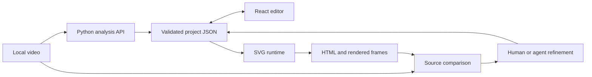

# Architecture

Saegim is a local application with a reusable rendering engine and repository-specific agent instructions.

| Module | Responsibility |
| --- | --- |
| `src/App.tsx`, `src/components/` | Import, edit, compare, save and export |
| `src/engine/` | Validate projects, evaluate time, render SVG and export HTML |
| `server/` | Probe local media, detect cuts, OCR, fit and track observed shapes |
| `scripts/workflow.mjs` | Route documented workflow commands |
| `scripts/catalog.json` | Public scripts and their input/output contracts |
| `.agents/skills/` | Instructions for using the actual repository tools |

## Data boundaries

The application accepts schema 1 projects and schema 2 compressed compositions. Processing segments in a composition do not automatically represent real scene cuts. Preserve the distinction between processing segments, editing ranges and detected cuts.

`object-scene-v1` is an experimental tracking model used by `object_scene_tracks.py` and `object-scene-runtime.mjs`. The parametric experiment has its own model. Neither is interchangeable with app project JSON. See [script contracts](scripts.md).

## Rendering invariants

Preserve stable element IDs, real editable text, z-order, clipping, gradients and time semantics. Do not interpolate across cuts. Frame redraw evaluates an observation and creates a fresh SVG; it does not blend adjacent full frames or invent observations. Timing and edited text must survive JSON and HTML export.

Part matching compares actual candidate renders against a fixed baseline and caller-selected source regions. Occluded geometry is an estimate, not recovered source design data. Metrics and overlays support visual inspection but do not establish universal reconstruction accuracy.

## Local data and publication

Uploaded media, generated projects, renders and comparison reports belong in ignored directories such as `.data/` and `artifacts/`. Keep source titles, palettes, object identities and manual masks in per-input artifacts rather than production code.

Public examples use authored synthetic data. The README's reconstruction/edit examples are actual analysis outputs from that data, deliberately reviewed for documentation. User media and ordinary generated outputs remain ignored. The publication scanner and ZIP builder select public source files and verify their contents; they do not publish to GitHub. Local API endpoints are development services without multi-user authentication; see [security guidance](../SECURITY.md).
